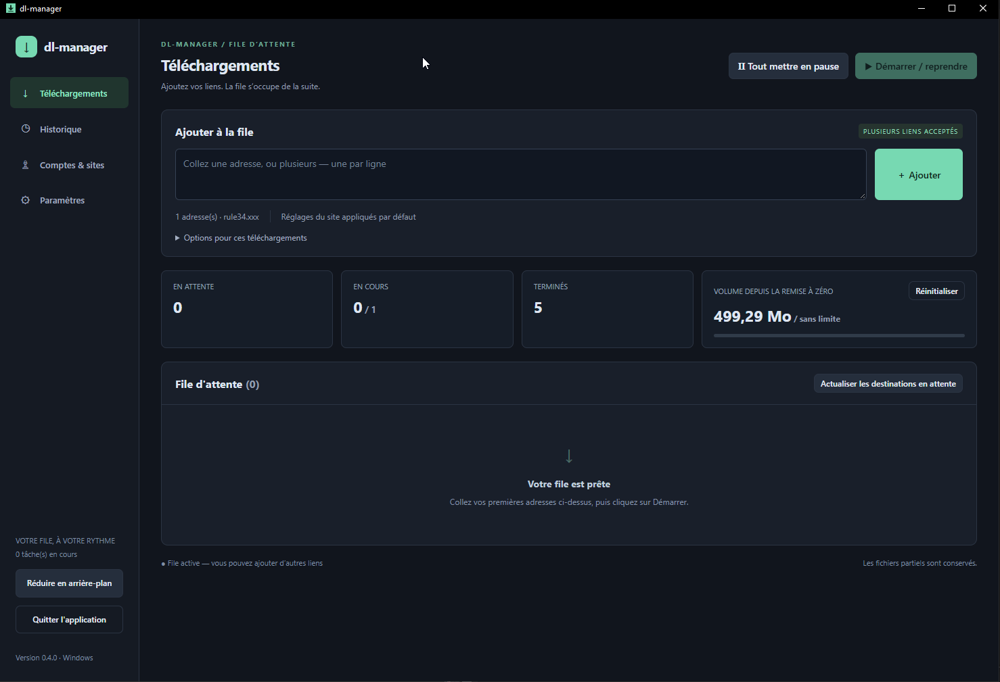
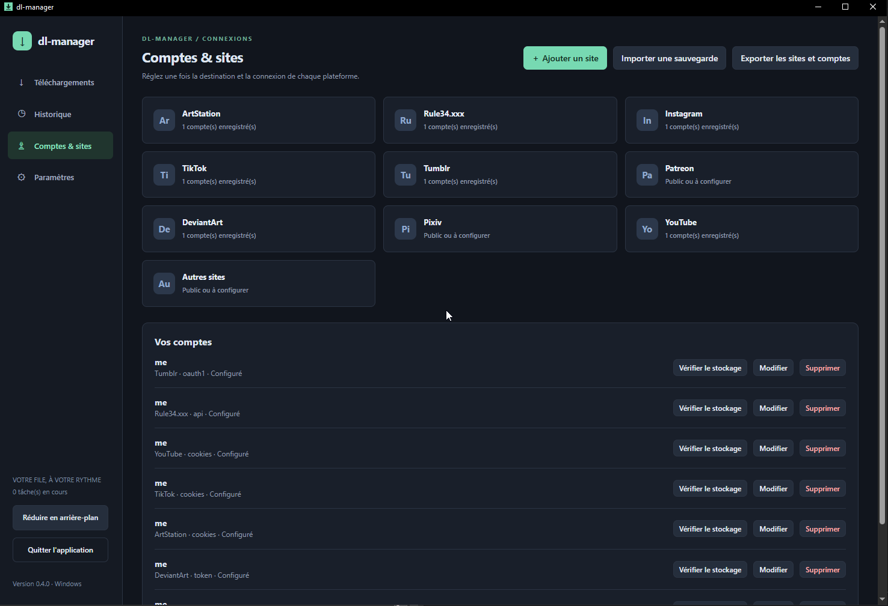

# dl-manager 0.5.0

> I'm not a developer, but I have an idea!

[Français](guide.fr.md) · [English](README.en.md) · [Español](README.es.md) · [简体中文](README.zh-CN.md) · [日本語](README.ja.md)

❤️ [Support the project](https://revolut.me/ludwigccae)

A desktop interface for gallery-dl and yt-dlp: paste links, choose images or videos, and start the queue. Download engines and their dependencies come with the packages.

## Download and start

Open [Releases](https://github.com/pandazor/mix-dl/releases) and expand **Assets** for the version you want.

| System | Archive | Start |
| --- | --- | --- |
| Windows 10/11 x64 | dl-manager-0.5.0-windows-x64.zip | Extract everything, then open dl-manager.exe |
| Linux x64 | dl-manager-0.5.0-linux-x64.tar.gz | Extract everything, then run ./dl-manager |

The **sources** ZIP contains code, not a ready-to-run application. Keep the executable and tools folder together. Windows needs [WebView2 Runtime](https://developer.microsoft.com/microsoft-edge/webview2/).

On Debian/Ubuntu with a graphical desktop:

```sh
sudo apt install libgtk-4-1 libwebkitgtk-6.0-4 libsecret-tools
tar -xzf dl-manager-0.5.0-linux-x64.tar.gz
cd dl-manager
./dl-manager
```

To save accounts on Linux, a compatible Secret Service keyring must be running and unlocked, such as GNOME Keyring or compatible KWallet. The Linux build is verified; native launch still needs validation. Wails' purego backend is experimental.

**Updating:** fully quit the old application. Back up and keep data and your downloads, then replace the program and tools with the new package. Do not run two versions against the same data. To move to another PC or OS, use encrypted account export.

## Your first download

1. Open **Settings → Language** and choose Français, English, Español, 简体中文 or 日本語. The change is immediate and saved automatically.
2. Choose the **Global download folder**. It is saved when you leave the field. Use the bottom button to save other settings.
3. Open your site under **Accounts & sites**, check **Use the global folder**, then save its settings. A site-specific folder otherwise takes priority.
4. Add an account if sign-in is required, as explained below.
5. Under **Downloads**, paste one or more addresses, one per line. Click **Add**, then **Start / resume**.



*Author-supplied screenshot of the French 0.4.0 interface. The language selector is available in Settings from 0.5.0.*

## Supported sites and test status

“Confirmed” means the author successfully downloaded tested content. It does not guarantee every type of content or future site availability.

| Site | Simplest sign-in method | Test status |
| --- | --- | --- |
| Rule34.xxx | User ID + API Key | Downloads confirmed |
| Instagram | cookies.txt | Images and cookies confirmed |
| TikTok | cookies.txt | Downloads confirmed |
| ArtStation | Public access or cookies.txt | Downloads confirmed |
| DeviantArt | Generate token or manual refresh-token | Downloads confirmed with manual token; new button needs a real-account test |
| Tumblr | Generate token (two values) | Authorization obtained; downloads unconfirmed, shared quota issue encountered |
| YouTube | Public access or cookies.txt if requested | Integrated through yt-dlp; user validation pending |
| Patreon | cookies.txt from an account with access | Integrated; validation pending |
| Pixiv | Refresh token | Integrated; validation pending |
| Other / custom sites | Public access or cookies.txt | Depends on [gallery-dl support](https://gdl-org.github.io/docs/supportedsites.html) |



*French 0.4.0 screenshot. A configured account does not prove successful sign-in to the site.*

## Simple example: Instagram with cookies.txt

1. Sign in to Instagram in your browser and open a page from the account you want to download.
2. Use [Get cookies.txt LOCALLY for Chrome/Chromium](https://chromewebstore.google.com/detail/get-cookiestxt-locally/cclelndahbckbenkjhflpdbgdldlbecc) or [cookies.txt for Firefox](https://addons.mozilla.org/firefox/addon/cookies-txt/). Check the exact extension name. See the [yt-dlp cookie guidance](https://github.com/yt-dlp/yt-dlp/wiki/FAQ#how-do-i-pass-cookies-to-yt-dlp).
3. From the signed-in Instagram tab, open the extension and export **only the current site's cookies** in **Netscape format**. Do not export all sites. Save as instagram-cookies.txt, for example.
4. Open **Accounts & sites → Instagram**, name the account, choose **cookies.txt file**, select your export, optionally make it the default, and click **Save account**.
5. Under **Downloads**, paste the profile or post address, for example https://www.instagram.com/ACCOUNT_NAME/ with ACCOUNT_NAME replaced, then **Add → Start / resume**.

Use the same approach for TikTok, ArtStation, Patreon and YouTube when sign-in is needed: export the right site's cookies from the right account. Cookies grant access to your session: **never share them or commit them to Git**. The original file stays on disk after import; remove it when no longer needed. If the session expires, sign in again and export fresh cookies.

## Tokens and site settings

- **Rule34:** sign in, open account options, then API. Copy **User ID** and **API Key** into their fields. Never put the key in a URL.
- **Tumblr / DeviantArt:** click **Generate token**, sign in in your browser and authorize gallery-dl. When the fields are filled, click **Save account**. Attempts expire after five minutes; local port 6414 must be free. Closing the dialog or cancelling stops the attempt. The new button's complete flow still needs real-account validation.
- **Manual entry:** Tumblr access-token goes in **Token / API Key**, access-token-secret in **OAuth Token Secret**. For DeviantArt, put the refresh-token in **Token / API Key**.
- **Pixiv:** obtain a refresh-token using the [gallery-dl procedure](https://gdl-org.github.io/docs/configuration.html#extractor-pixiv-refresh-token). A password or cookie file is not a replacement.
- **Tumblr quota:** successful authorization does not mean quota is available. The shared application key may be exhausted; wait for the reset reported in the log. Renewing tokens does not reset the quota. Personal application keys are not supported yet.

The default account is resolved when a task starts, including tasks added before the account. You can change a paused task's account in **Details**. When editing, blank secret fields preserve existing values. **Check storage** tests local decryption, not site access.

**Add site:** enter a name and bare domain, without https:// or a path. Each entry has its own settings and accounts. Its domain and subdomains are recognized if gallery-dl supports them. Renaming does not move files. To delete an entry, first remove its accounts and tasks, including history.

## Folders, resume and errors

Folder priority: download override → site folder → global folder. An inherited folder is resolved on first start; **a task that has started keeps its folder for resuming**. For older tasks that never started, pause the queue and use **Refresh pending destinations**.

Organize downloads in a flat folder, by site, or by site/creator. Image/video filters and extensions select available formats; they do not convert media. One to three tasks can run at once, with serialization for shared folders or accounts. Volume quotas count added media bytes, not all network traffic; a small overshoot is possible. Resetting the counter pauses tasks and keeps files.

Downloads never start automatically when the app opens. An already-running queue processes newly added links. Keep data, partial files and destination folders to preserve resume information and avoid duplicates. **Removing a task** does not delete its files. On error, open **Details → Log**, fix the cause, then **↻ Queue again** and **Start / resume**. Raw logs and external errors keep their original language.

The window's **X quits the application** and stops tasks cleanly. **Run in background** keeps it running (notification area on Windows, minimized on Linux).

## Back up sites and accounts

Under **Accounts & sites → Export sites and accounts**, choose a new .dlmbackup file and a passphrase of at least **16 characters**. Export works during downloads. The file is encrypted, but anyone with the passphrase and file can use the credentials. The passphrase is not stored and cannot be recovered.

To import, pause the queue and wait for active tasks to stop. Import adds accounts and keeps existing ones: importing the same file again creates duplicates. Existing settings are preserved unless replacement is selected. Check destinations after changing OS. The backup excludes **downloaded files, history, global settings and language**.

Windows accounts use DPAPI protection; Linux uses a key kept in Secret Service. Copying vault files does not make them usable by a different account or OS: use encrypted export.

## Contribute

Test reports and [issue reports](https://github.com/pandazor/mix-dl/issues) are welcome. If you find the app useful, you can [donate via Revolut](https://revolut.me/ludwigccae). Choose any amount; support is entirely optional.

The code uses **AGPL-3.0-only**: [license](../LICENSE). Bundled engines keep their own licenses: [notices](../THIRD_PARTY.md). [Validation and limits](../VALIDATION.md) and [technical/build notes](technical.fr.md) remain in French. Native speakers are welcome to improve the translations.
