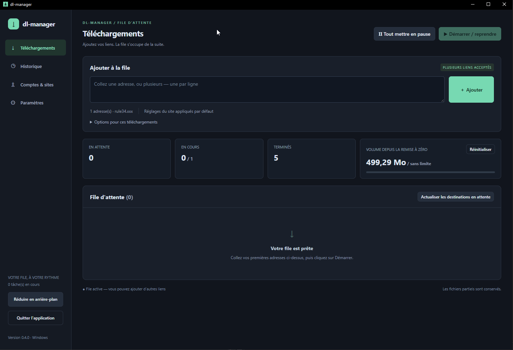
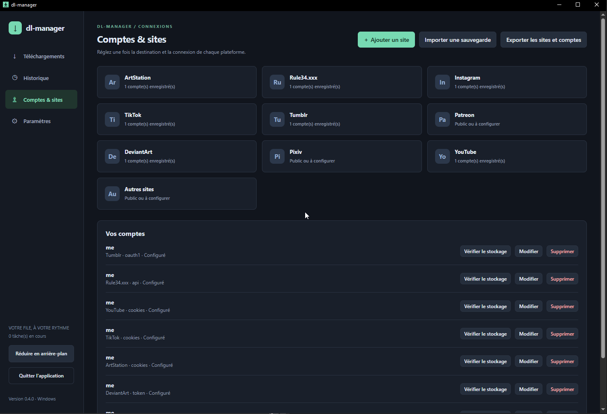

# dl-manager 0.5.0

> No soy desarrollador, ¡pero tengo una idea!

[Français](guide.fr.md) · [English](README.en.md) · [Español](README.es.md) · [简体中文](README.zh-CN.md) · [日本語](README.ja.md)

❤️ [Apoyar el proyecto](https://revolut.me/ludwigccae)

Una interfaz de escritorio para gallery-dl y yt-dlp: pega enlaces, elige imágenes o vídeos e inicia la cola. Los motores y sus dependencias están incluidos en los paquetes.

## Descargar e iniciar

Abre [Releases](https://github.com/pandazor/mix-dl/releases) y los **Assets** de la versión que quieras.

| Sistema | Archivo | Inicio |
| --- | --- | --- |
| Windows 10/11 x64 | dl-manager-0.5.0-windows-x64.zip | Extrae todo y abre dl-manager.exe |
| Linux x64 | dl-manager-0.5.0-linux-x64.tar.gz | Extrae todo y ejecuta ./dl-manager |

El ZIP **sources** contiene el código, no el programa listo para usar. Conserva juntos el ejecutable y la carpeta tools. Windows necesita [WebView2 Runtime](https://developer.microsoft.com/microsoft-edge/webview2/).

En Debian/Ubuntu con escritorio gráfico:

```sh
sudo apt install libgtk-4-1 libwebkitgtk-6.0-4 libsecret-tools
tar -xzf dl-manager-0.5.0-linux-x64.tar.gz
cd dl-manager
./dl-manager
```

Para guardar cuentas en Linux debe estar abierto y desbloqueado un llavero compatible con Secret Service, como GNOME Keyring o KWallet compatible. La compilación Linux está verificada; falta validar el inicio nativo. El backend purego de Wails es experimental.

**Actualizar:** cierra completamente la versión anterior. Haz una copia y conserva data y las descargas; después reemplaza el programa y tools por los del nuevo paquete. No ejecutes dos versiones sobre los mismos datos. Para cambiar de equipo o sistema operativo, usa la exportación cifrada de cuentas.

## Primera descarga

1. En **Configuración → Idioma**, elige Français, English, Español, 简体中文 o 日本語. El cambio es inmediato y se guarda automáticamente.
2. Elige la **Carpeta global de descarga**. Se guarda al salir del campo. Guarda los demás ajustes con el botón inferior.
3. En **Cuentas y sitios**, abre tu sitio, activa **Usar la carpeta global** y guarda los ajustes. Si eliges una carpeta propia del sitio, esta tendrá prioridad.
4. Añade una cuenta si el contenido requiere iniciar sesión.
5. En **Descargas**, pega una o varias direcciones, una por línea. Pulsa **Añadir** y **Iniciar / reanudar**.



*Captura proporcionada por el autor: interfaz francesa 0.4.0. El selector de idioma está disponible en Configuración a partir de 0.5.0.*

## Sitios y estado de las pruebas

«Confirmado» significa que el autor descargó correctamente el contenido probado; no garantiza todos los contenidos ni la disponibilidad futura del sitio.

| Sitio | Método más sencillo | Estado |
| --- | --- | --- |
| Rule34.xxx | User ID + API Key | Descargas confirmadas |
| Instagram | cookies.txt | Imágenes y cookies confirmadas |
| TikTok | cookies.txt | Descargas confirmadas |
| ArtStation | Público o cookies.txt | Descargas confirmadas |
| DeviantArt | Generar token o refresh-token manual | Descargas confirmadas con token manual; falta probar el nuevo botón con una cuenta real |
| Tumblr | Generar token (dos valores) | Autorización obtenida; descarga no confirmada, problema de cuota compartida |
| YouTube | Público o cookies.txt si lo solicita | Integrado mediante yt-dlp; falta validación del usuario |
| Patreon | cookies.txt de una cuenta con acceso | Integrado; pendiente de validar |
| Pixiv | Refresh token | Integrado; pendiente de validar |
| Otros / personalizados | Público o cookies.txt | Depende de la [compatibilidad de gallery-dl](https://gdl-org.github.io/docs/supportedsites.html) |



*Interfaz francesa 0.4.0. Una cuenta configurada no demuestra que se haya validado la conexión al sitio.*

## Ejemplo sencillo: Instagram con cookies.txt

1. Inicia sesión en Instagram en el navegador y abre una página de la cuenta que quieras descargar.
2. Usa [Get cookies.txt LOCALLY para Chrome/Chromium](https://chromewebstore.google.com/detail/get-cookiestxt-locally/cclelndahbckbenkjhflpdbgdldlbecc) o [cookies.txt para Firefox](https://addons.mozilla.org/firefox/addon/cookies-txt/). Comprueba el nombre exacto de la extensión. Consulta la [guía de cookies de yt-dlp](https://github.com/yt-dlp/yt-dlp/wiki/FAQ#how-do-i-pass-cookies-to-yt-dlp).
3. En la pestaña de Instagram con la sesión abierta, abre la extensión y exporta **solo las cookies del sitio actual**, en formato **Netscape**. No exportes todos los sitios. Guarda, por ejemplo, instagram-cookies.txt.
4. En **Cuentas y sitios → Instagram**, da un nombre a la cuenta, elige **Archivo cookies.txt**, selecciona el archivo y marca la cuenta predeterminada si quieres. Pulsa **Guardar cuenta**.
5. En **Descargas**, pega la dirección del perfil o publicación; por ejemplo, https://www.instagram.com/NOMBRE_DE_CUENTA/ sustituyendo NOMBRE_DE_CUENTA. Pulsa **Añadir → Iniciar / reanudar**.

El mismo método sirve para TikTok, ArtStation, Patreon y YouTube cuando piden iniciar sesión: exporta las cookies del sitio y de la cuenta correctos. Las cookies dan acceso a tu sesión: **no las compartas ni las añadas al repositorio Git**. El archivo original sigue en el disco después de importarlo; elimínalo cuando ya no lo necesites. Si caduca la sesión, inicia sesión de nuevo y repite la exportación.

## Tokens y ajustes del sitio

- **Rule34:** inicia sesión, abre las opciones de la cuenta y la sección API. Copia **User ID** y **API Key** en sus campos. Nunca pongas la clave en una URL.
- **Tumblr / DeviantArt:** pulsa **Generar token**, inicia sesión en el navegador y autoriza gallery-dl. Cuando se rellenen los campos, pulsa **Guardar cuenta**. Cada intento dura como máximo cinco minutos y necesita el puerto local 6414 libre. Cerrar el diálogo o cancelar detiene el intento. Falta validar el recorrido completo del nuevo botón con cuentas reales.
- **Entrada manual:** en Tumblr, access-token va en **Token / API Key** y access-token-secret en **OAuth Token Secret**. En DeviantArt, pega el refresh-token en **Token / API Key**.
- **Pixiv:** consigue un refresh-token siguiendo el [procedimiento de gallery-dl](https://gdl-org.github.io/docs/configuration.html#extractor-pixiv-refresh-token). Una contraseña o un archivo de cookies no lo sustituyen.
- **Cuota de Tumblr:** obtener autorización no garantiza que quede cuota. La clave compartida puede estar agotada; espera al restablecimiento indicado en el registro. Renovar los tokens no reinicia esa cuota. Las claves de aplicaciones personales todavía no se admiten.

La cuenta predeterminada se resuelve al iniciar las tareas que la heredan, incluso si se añadieron antes que la cuenta. Puedes cambiar la cuenta de una tarea pausada en **Detalles**. Al editar, los campos secretos vacíos conservan su valor. **Verificar almacenamiento** comprueba el descifrado local, no el acceso al sitio.

**Añadir sitio:** indica un nombre y el dominio solo, sin https:// ni ruta. Cada ficha tiene sus ajustes y cuentas. Se reconocerán el dominio y sus subdominios si gallery-dl es compatible. Cambiar el nombre no mueve archivos. Para eliminar la ficha, retira primero sus cuentas y tareas, incluidas las del historial.

## Carpetas, reanudación y errores

Prioridad de carpetas: opción de la descarga → carpeta del sitio → carpeta global. La carpeta heredada se decide al iniciar por primera vez; **las tareas ya iniciadas conservan su carpeta para reanudarse**. Para tareas antiguas nunca iniciadas, pausa la cola y pulsa **Actualizar destinos pendientes**.

Puedes organizar en una sola carpeta, por sitio o por sitio/creador. Los filtros de imágenes, vídeos y extensiones seleccionan formatos disponibles; no convierten archivos. Se permiten de una a tres tareas simultáneas, con ejecución secuencial para carpetas o cuentas compartidas. La cuota cuenta bytes de contenido añadidos, no todo el tráfico de red; puede superarse ligeramente. Restablecer el contador pausa las tareas sin borrar archivos.

Al abrir la aplicación no se inicia ninguna descarga automáticamente. Una cola activa procesa los nuevos enlaces. Conserva data, los archivos parciales y los destinos para reanudar y evitar duplicados. **Retirar una tarea** no borra sus archivos. Si hay un error, abre **Detalles → Registro**, corrige la causa y pulsa **↻ Volver a poner en espera**, después **Iniciar / reanudar**. Los registros y errores externos conservan su idioma original.

La **X cierra la aplicación** y detiene las tareas correctamente. **Mantener en segundo plano** deja la aplicación funcionando: área de notificación en Windows, minimizada en Linux.

## Copias de sitios y cuentas

En **Cuentas y sitios → Exportar sitios y cuentas**, elige un archivo .dlmbackup nuevo y una frase secreta de al menos **16 caracteres**. Puedes exportar durante las descargas. El archivo está cifrado, pero quien tenga también la frase podrá usar las credenciales. La frase no se guarda ni se puede recuperar.

Para importar, pausa la cola y espera a que se detengan las tareas. La importación añade cuentas y conserva las existentes: repetir el mismo archivo crea duplicados. Los ajustes existentes se conservan salvo que marques reemplazarlos. Revisa los destinos al cambiar de sistema. La copia no incluye **descargas, historial, ajustes globales ni idioma**.

Windows protege las cuentas con DPAPI; Linux utiliza una clave de Secret Service. Copiar los archivos del almacén no permite utilizarlos en otra cuenta o sistema: usa la exportación cifrada.

## Participar

Se agradecen pruebas y [avisos de problemas](https://github.com/pandazor/mix-dl/issues). Si la aplicación te resulta útil, puedes [hacer una donación mediante Revolut](https://revolut.me/ludwigccae). Tú eliges el importe y el apoyo es totalmente voluntario.

Código bajo **AGPL-3.0-only**: [licencia](../LICENSE). Los motores conservan sus licencias: [avisos](../THIRD_PARTY.md). La [validación y sus límites](../VALIDATION.md) y las [notas técnicas y de compilación](technical.fr.md) permanecen en francés. Las mejoras de hablantes nativos son bienvenidas.
