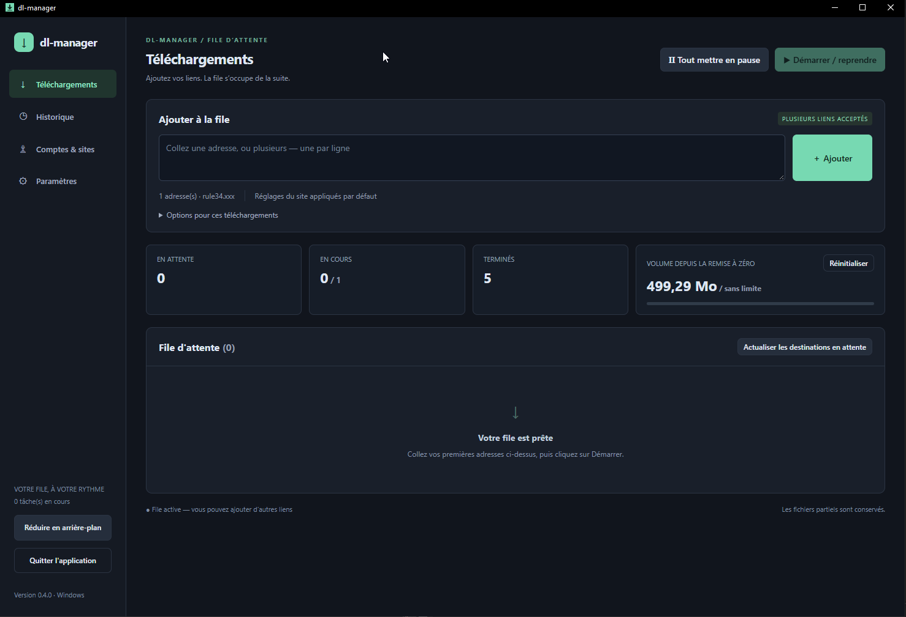
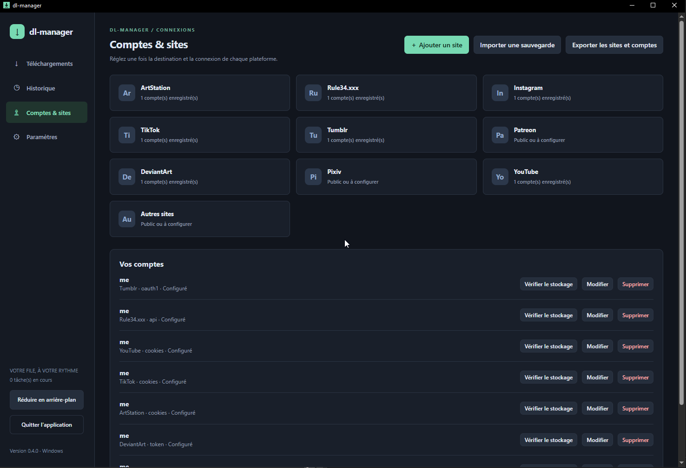

# dl-manager 0.5.0

> 開発者ではないけれど、アイデアはある！

[Français](guide.fr.md) · [English](README.en.md) · [Español](README.es.md) · [简体中文](README.zh-CN.md) · [日本語](README.ja.md)

❤️ [プロジェクトを支援](https://revolut.me/ludwigccae)

gallery-dl と yt-dlp のデスクトップ用インターフェースです。リンクを貼り付け、画像や動画を選び、キューを開始するだけでダウンロードできます。エンジンとその依存ツールはパッケージに同梱されています。

## ダウンロードと起動

[Releases](https://github.com/pandazor/mix-dl/releases) を開き、使用するバージョンの **Assets** を展開してください。

| システム | アーカイブ | 起動方法 |
| --- | --- | --- |
| Windows 10/11 x64 | dl-manager-0.5.0-windows-x64.zip | すべて展開して dl-manager.exe を起動 |
| Linux x64 | dl-manager-0.5.0-linux-x64.tar.gz | すべて展開して ./dl-manager を実行 |

**sources** ZIP はソースコードであり、そのまま起動できるアプリではありません。実行ファイルと tools フォルダーは同じ場所に置いてください。Windows には [WebView2 Runtime](https://developer.microsoft.com/microsoft-edge/webview2/) が必要です。

グラフィカルデスクトップのある Debian/Ubuntu では、次のように実行します。

```sh
sudo apt install libgtk-4-1 libwebkitgtk-6.0-4 libsecret-tools
tar -xzf dl-manager-0.5.0-linux-x64.tar.gz
cd dl-manager
./dl-manager
```

Linux でアカウントを保存するには、GNOME Keyring や対応する KWallet など、Secret Service 対応のキーリングが起動し、ロック解除されている必要があります。Linux 版のビルドは確認済みですが、ネイティブ環境での起動検証は未完了です。Wails の purego バックエンドは実験的なものです。

**更新するには：**旧バージョンを完全に終了します。data とダウンロード済みファイルをバックアップして保持し、新しいパッケージのプログラムと tools に置き換えてください。同じデータを使って 2 つのバージョンを同時に実行しないでください。別の PC や OS に移す場合は、アカウントの暗号化エクスポートを利用します。

## 最初のダウンロード

1. **設定 → 言語**で Français、English、Español、简体中文、日本語から選びます。変更はすぐに適用され、自動保存されます。
2. **共通ダウンロードフォルダー**を選びます。入力欄から移動すると保存されます。その他の設定は下部のボタンで保存してください。
3. **アカウントとサイト**で対象サイトを開き、**共通フォルダーを使用**にチェックしてサイト設定を保存します。サイト専用フォルダーを指定した場合は、そちらが優先されます。
4. ログインが必要な場合は、以下の手順でアカウントを追加します。
5. **ダウンロード**にアドレスを 1 行に 1 件ずつ貼り付けます。**追加**、**開始／再開**の順にクリックします。



*作者提供の 0.4.0 フランス語画面です。言語選択は 0.5.0 以降の設定画面にあります。*

## 対応サイトと確認状況

「確認済み」は、作者が試したコンテンツをダウンロードできたことを意味します。すべてのコンテンツや、サイトの今後の動作を保証するものではありません。

| サイト | 簡単な認証方法 | 確認状況 |
| --- | --- | --- |
| Rule34.xxx | User ID + API Key | ダウンロード確認済み |
| Instagram | cookies.txt | 画像と Cookie の利用を確認済み |
| TikTok | cookies.txt | ダウンロード確認済み |
| ArtStation | 公開アクセスまたは cookies.txt | ダウンロード確認済み |
| DeviantArt | トークンを生成、または refresh-token の手動入力 | 手動トークンで確認済み。新しいボタンは実アカウントでの検証待ち |
| Tumblr | トークンを生成（2 つの値） | 認可は取得済み。ダウンロード未確認、共有の割り当て制限が発生 |
| YouTube | 公開アクセス、必要時は cookies.txt | yt-dlp 経由で実装済み。ユーザー検証待ち |
| Patreon | 閲覧権限のあるアカウントの cookies.txt | 実装済み、検証待ち |
| Pixiv | Refresh token | 実装済み、検証待ち |
| その他／カスタムサイト | 公開アクセスまたは cookies.txt | [gallery-dl の対応状況](https://gdl-org.github.io/docs/supportedsites.html)に依存 |



*0.4.0 のフランス語画面です。「設定済み」と表示されても、サイトへのログイン成功を確認したことにはなりません。*

## 簡単な例：cookies.txt で Instagram を使う

1. ブラウザーで Instagram にログインし、ダウンロードしたいアカウントのページを開きます。
2. Chrome/Chromium では [Get cookies.txt LOCALLY](https://chromewebstore.google.com/detail/get-cookiestxt-locally/cclelndahbckbenkjhflpdbgdldlbecc)、Firefox では [cookies.txt](https://addons.mozilla.org/firefox/addon/cookies-txt/) を使用します。拡張機能の正確な名前を確認してください。[yt-dlp の Cookie に関する説明](https://github.com/yt-dlp/yt-dlp/wiki/FAQ#how-do-i-pass-cookies-to-yt-dlp)も参照できます。
3. ログイン済みの Instagram タブで拡張機能を開き、**現在のサイトの Cookie のみ**を **Netscape 形式**で出力します。ブラウザーの全サイトを出力しないでください。ファイル名は instagram-cookies.txt などにします。
4. **アカウントとサイト → Instagram**で名前を入力し、**cookies.txt ファイル**を選んで出力したファイルを指定します。必要なら既定アカウントに設定し、**アカウントを保存**をクリックします。
5. **ダウンロード**にプロフィールまたは投稿のアドレスを貼り付けます。例：https://www.instagram.com/ACCOUNT_NAME/ の ACCOUNT_NAME を実際の名前に置き換えてください。**追加 → 開始／再開**をクリックします。

TikTok、ArtStation、Patreon、YouTube でも、ログインが必要な場合は同様です。正しいアカウントから、そのサイトの Cookie を出力してください。Cookie はログインセッションへのアクセスを許す情報です。**共有したり、Git リポジトリに登録したりしないでください**。取り込み後も元ファイルはディスクに残るので、不要になったら削除してください。セッションが期限切れになった場合は、再ログインして出力し直します。

## トークンとサイトの設定

- **Rule34：**ログインし、アカウント設定の API 欄を開きます。**User ID** と **API Key** を各欄に入力してください。キーを URL に入れないでください。
- **Tumblr／DeviantArt：** **トークンを生成**をクリックし、ブラウザーでログインして gallery-dl を許可します。欄が入力されたら **アカウントを保存**をクリックしてください。1 回の試行は最長 5 分で、ローカルポート 6414 が空いている必要があります。ダイアログを閉じるかキャンセルすると中断します。新しいボタンの一連の動作は、実アカウントでの検証が残っています。
- **手動入力：**Tumblr の access-token は **Token / API Key**、access-token-secret は **OAuth Token Secret** に入力します。DeviantArt の refresh-token は **Token / API Key** に入力します。
- **Pixiv：**[gallery-dl の手順](https://gdl-org.github.io/docs/configuration.html#extractor-pixiv-refresh-token)で refresh-token を取得します。パスワードや Cookie ファイルでは代用できません。
- **Tumblr の制限：**認可が成功しても、利用可能な割り当てが残っているとは限りません。共有アプリキーが上限に達した場合は、ログに表示されるリセット時刻まで待ってください。トークンを更新しても制限は解除されません。個人用アプリキーには未対応です。

既定アカウントは、設定を引き継ぐタスクが開始するときに決まります。アカウント追加前に登録したタスクにも適用されます。一時停止したタスクのアカウントは **詳細**で変更できます。編集時に秘密情報の欄を空にすると、既存の値を保持します。**保存状態を確認**はローカルで復号できるかを調べる機能で、サイトへのアクセス確認ではありません。

**サイトを追加：**名前とドメインのみを入力します。https:// やパスは不要です。各サイトに設定とアカウントを持たせられます。gallery-dl が対応していれば、指定ドメインとサブドメインを認識します。名前を変更してもファイルは移動しません。サイトを削除するには、履歴を含む関連タスクとアカウントを先に削除してください。

## フォルダー、再開、エラー

保存先の優先順位は、個別ダウンロードの指定 → サイトのフォルダー → 共通フォルダーです。引き継ぐフォルダーは初回開始時に決まり、**開始済みのタスクは再開時も同じフォルダーを使います**。未開始の古いタスクは、キューを停止して **待機中の保存先を更新**を使ってください。

フォルダーの整理は、分類なし、サイト別、サイト／作者別から選べます。画像・動画・拡張子のフィルターは配信元にある形式を選ぶだけで、形式変換は行いません。同時実行は 1～3 件ですが、同じフォルダーやアカウントを共有するタスクは順に実行します。容量制限は追加されたメディアのバイト数を数え、すべての通信量を数えるものではありません。少し超過する場合があります。カウンターのリセットはタスクを停止しますが、ファイルを削除しません。

アプリの起動時に自動でダウンロードは始まりません。実行中のキューには新しいリンクを追加できます。再開と重複防止のため、data、途中のファイル、保存先を保持してください。**タスクの削除**でダウンロード済みファイルは消えません。エラー時は **詳細 → ログ**で原因を確認・修正し、**↻ 再び待機状態にする**、**開始／再開**を使います。生のログと外部エラーは元の言語のままです。

ウィンドウの **X はアプリを終了**し、タスクを正常に停止します。**バックグラウンドへ**を使うと実行を継続します。Windows では通知領域に入り、Linux では最小化します。

## サイトとアカウントのバックアップ

**アカウントとサイト → サイトとアカウントをエクスポート**で、新しい .dlmbackup ファイルと **16 文字以上**のパスフレーズを指定します。ダウンロード中でも実行できます。ファイルは暗号化されますが、ファイルとパスフレーズを持つ人は認証情報を利用できます。パスフレーズは保存されず、復元もできません。

インポート前にキューを停止し、実行中タスクの停止を待ちます。既存アカウントを残して新しいアカウントを追加するため、同じファイルを再度取り込むと重複します。置き換えを選ばなければ既存のサイト設定は保持されます。OS を変更した場合は保存先を確認してください。**ダウンロード済みファイル、履歴、共通設定、言語設定**はバックアップに含まれません。

Windows では DPAPI、Linux では Secret Service に保管したキーでアカウントを保護します。保管庫ファイルをコピーしても、別のユーザーや OS では利用できません。暗号化エクスポートを使ってください。

## プロジェクトへの参加

テスト結果や[不具合報告](https://github.com/pandazor/mix-dl/issues)を歓迎します。このアプリが役に立ったら、[Revolut で寄付](https://revolut.me/ludwigccae)できます。金額は自由で、支援は完全に任意です。

コードは **AGPL-3.0-only**：[ライセンス](../LICENSE)。同梱エンジンにはそれぞれのライセンスが適用されます：[第三者のライセンス](../THIRD_PARTY.md)。[検証状況と制限](../VALIDATION.md)、[技術・ビルド資料](technical.fr.md)はフランス語です。翻訳を改善する母語話者の協力も歓迎します。
