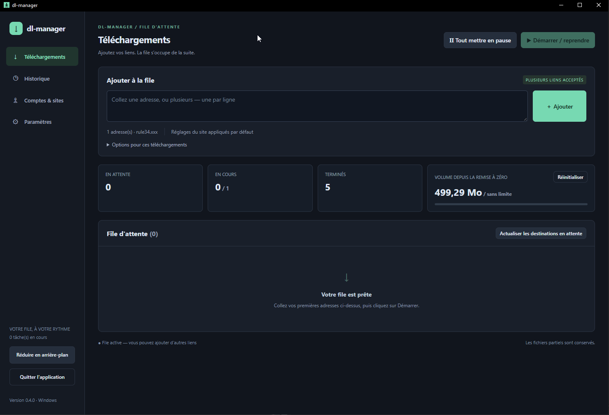
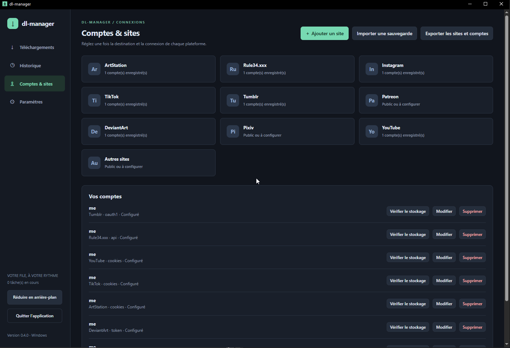

# dl-manager 0.5.0

> 我不是开发者，但我有一个想法！

[Français](guide.fr.md) · [English](README.en.md) · [Español](README.es.md) · [简体中文](README.zh-CN.md) · [日本語](README.ja.md)

❤️ [支持项目](https://revolut.me/ludwigccae)

dl-manager 为 gallery-dl 和 yt-dlp 提供桌面界面：粘贴链接，选择图片或视频，然后启动下载队列。软件包已包含下载引擎及其依赖。

## 下载与启动

打开 [Releases](https://github.com/pandazor/mix-dl/releases)，展开所需版本的 **Assets**。

| 系统 | 软件包 | 启动方式 |
| --- | --- | --- |
| Windows 10/11 x64 | dl-manager-0.5.0-windows-x64.zip | 完整解压后运行 dl-manager.exe |
| Linux x64 | dl-manager-0.5.0-linux-x64.tar.gz | 完整解压后运行 ./dl-manager |

**sources** ZIP 是源代码，不是可直接运行的应用。请将程序与 tools 文件夹放在一起。Windows 需要安装 [WebView2 Runtime](https://developer.microsoft.com/microsoft-edge/webview2/)。

在带有图形桌面的 Debian/Ubuntu 上：

```sh
sudo apt install libgtk-4-1 libwebkitgtk-6.0-4 libsecret-tools
tar -xzf dl-manager-0.5.0-linux-x64.tar.gz
cd dl-manager
./dl-manager
```

要在 Linux 上保存账户，需要运行并解锁兼容 Secret Service 的密钥环，例如 GNOME Keyring 或兼容的 KWallet。Linux 版本已通过编译验证，但尚需验证原生运行。Wails 的 purego 后端仍属实验性质。

**更新：**先彻底退出旧版本。备份并保留 data 文件夹及下载文件，再用新软件包中的程序和 tools 替换旧文件。不要让两个版本同时使用同一份数据。迁移到另一台电脑或操作系统时，请使用账户的加密导出功能。

## 第一次下载

1. 在 **设置 → 语言** 中选择 Français、English、Español、简体中文或日本語。更改会立即生效并自动保存。
2. 选择 **全局下载文件夹**。离开输入框后会自动保存；其他设置请点击底部按钮保存。
3. 在 **账户与站点** 中打开目标站点，勾选 **使用全局文件夹**，然后保存站点设置。否则，站点专用文件夹会优先使用。
4. 如果需要登录，请按下方说明添加账户。
5. 在 **下载** 中粘贴一个或多个地址，每行一个。点击 **添加**，再点击 **开始／恢复**。



*作者提供的 0.4.0 法语界面截图。0.5.0 起可在设置中选择语言。*

## 支持的站点及测试状态

“已确认”表示作者已成功下载测试过的内容，并不保证所有内容或站点未来始终可用。

| 站点 | 最简单的登录方式 | 测试状态 |
| --- | --- | --- |
| Rule34.xxx | User ID + API Key | 已确认下载 |
| Instagram | cookies.txt | 已确认图片下载及 Cookie 登录 |
| TikTok | cookies.txt | 已确认下载 |
| ArtStation | 公开访问或 cookies.txt | 已确认下载 |
| DeviantArt | 生成令牌或手动填写 refresh-token | 手动令牌下载已确认；新按钮仍需真实账户测试 |
| Tumblr | 生成令牌（两个值） | 已取得授权；下载未确认，遇到共享配额问题 |
| YouTube | 公开访问，或按需使用 cookies.txt | 已通过 yt-dlp 集成；用户验证待完成 |
| Patreon | 有权访问内容的账户所导出的 cookies.txt | 已集成，待验证 |
| Pixiv | Refresh token | 已集成，待验证 |
| 其他／自定义站点 | 公开访问或 cookies.txt | 取决于 [gallery-dl 的支持情况](https://gdl-org.github.io/docs/supportedsites.html) |



*0.4.0 法语界面截图。显示“已配置”的账户不代表已验证站点登录成功。*

## 简单示例：使用 cookies.txt 下载 Instagram

1. 在浏览器中登录 Instagram，打开希望下载的账户页面。
2. 使用 Chrome/Chromium 的 [Get cookies.txt LOCALLY](https://chromewebstore.google.com/detail/get-cookiestxt-locally/cclelndahbckbenkjhflpdbgdldlbecc)，或 Firefox 的 [cookies.txt](https://addons.mozilla.org/firefox/addon/cookies-txt/)。请核对扩展的准确名称，并参考 [yt-dlp 的 Cookie 说明](https://github.com/yt-dlp/yt-dlp/wiki/FAQ#how-do-i-pass-cookies-to-yt-dlp)。
3. 在已登录 Instagram 的标签页中打开扩展，以 **Netscape 格式**导出 **仅当前站点的 Cookie**。不要导出浏览器内所有站点的 Cookie。可将文件命名为 instagram-cookies.txt。
4. 打开 **账户与站点 → Instagram**，填写账户名称，选择 **cookies.txt 文件**，选中导出的文件。需要时将其设为默认账户，然后点击 **保存账户**。
5. 在 **下载** 中粘贴个人主页或帖子的地址，例如 https://www.instagram.com/ACCOUNT_NAME/，并将 ACCOUNT_NAME 替换为实际账户名称。然后点击 **添加 → 开始／恢复**。

TikTok、ArtStation、Patreon 和 YouTube 需要登录时也可采用同样的方法：从正确的账户导出正确站点的 Cookie。Cookie 可以访问您的登录会话：**不要分享，也不要提交到 Git 仓库**。导入后原始文件仍在磁盘上，不再需要时请删除。会话过期后，请重新登录并导出新的 Cookie。

## 令牌与站点设置

- **Rule34：**登录站点，打开账户选项中的 API 部分。将 **User ID** 和 **API Key** 填入对应字段。不要将密钥放入 URL。
- **Tumblr／DeviantArt：**点击 **生成令牌**，在浏览器中登录并授权 gallery-dl。字段自动填入后，点击 **保存账户**。每次尝试最多持续五分钟，本地端口 6414 必须空闲。关闭对话框或取消会中止此次尝试。新按钮的完整流程仍需使用真实账户验证。
- **手动输入：**Tumblr 的 access-token 填入 **Token / API Key**，access-token-secret 填入 **OAuth Token Secret**。DeviantArt 的 refresh-token 填入 **Token / API Key**。
- **Pixiv：**按 [gallery-dl 文档](https://gdl-org.github.io/docs/configuration.html#extractor-pixiv-refresh-token)取得 refresh-token。密码或 Cookie 文件不能替代它。
- **Tumblr 配额：**成功授权不代表仍有可用配额。共享应用密钥可能已用尽配额；请等待日志显示的重置时间。更新令牌不会重置配额。目前不支持个人应用密钥。

默认账户在任务启动时确定，也适用于早于账户添加时间建立的任务。暂停任务后，可在 **详情** 中修改该任务的账户。编辑账户时，敏感字段留空会保留原值。**检查存储**只验证本地解密，不验证站点访问权限。

**添加站点：**输入名称和纯域名，不含 https:// 或路径。每个站点配置都有独立设置和账户。若 gallery-dl 支持该站点，就能识别其域名及子域名。重命名不会移动文件。删除站点前，需要先移除关联账户和任务，包括历史记录中的任务。

## 文件夹、恢复与错误

保存位置优先级：单次下载选项 → 站点文件夹 → 全局文件夹。继承的文件夹会在首次开始时确定；**已经开始的任务会保留原文件夹用于恢复**。对于从未开始的旧任务，先暂停队列，再使用 **更新待处理任务的保存位置**。

可以不分类、按站点分类，或按站点／创作者分类。图片、视频和扩展名筛选只选择来源提供的格式，不会转换媒体。支持同时执行一至三个任务；共享文件夹或账户的任务会依次执行。配额统计新增媒体字节数，而非所有网络流量，因此可能略微超出限制。重置计数器会暂停任务，但不会删除文件。

打开应用时不会自动开始下载。已经运行的队列会处理新增链接。保留 data、未完成文件和保存文件夹，可维持断点续传与去重信息。**移除任务**不会删除其文件。发生错误时，打开 **详情 → 日志**，解决原因后点击 **↻ 重新加入队列**，再点击 **开始／恢复**。原始日志和外部错误保留原始语言。

窗口的 **X 会退出应用**并正常停止任务。**转入后台**会保持运行：Windows 使用通知区域，Linux 则最小化窗口。

## 备份站点和账户

在 **账户与站点 → 导出站点和账户** 中选择新的 .dlmbackup 文件，设置至少 **16 个字符**的口令。下载期间也可以导出。文件经过加密，但同时持有文件和口令的人仍能使用其中的凭据。口令不会保存，也无法找回。

导入前请暂停队列，并等待运行中的任务停止。导入会添加账户且保留现有账户，因此重复导入同一文件会产生重复项。除非勾选替换，否则现有站点设置会保留。更换操作系统后请检查保存位置。备份不包含 **下载文件、历史记录、全局设置或语言设置**。

Windows 使用 DPAPI 保护账户；Linux 使用存放在 Secret Service 中的密钥。直接复制凭据库文件不能使其在其他账户或操作系统中可用，请使用加密导出。

## 参与项目

欢迎提交测试反馈和 [问题报告](https://github.com/pandazor/mix-dl/issues)。如果这个工具对你有帮助，可以[通过 Revolut 捐赠](https://revolut.me/ludwigccae)。金额由你决定，捐赠完全自愿。

代码采用 **AGPL-3.0-only**：[许可证](../LICENSE)。下载引擎保留各自的许可证：[第三方声明](../THIRD_PARTY.md)。[验证记录与限制](../VALIDATION.md)及[技术／编译说明](technical.fr.md)仍为法语。欢迎母语使用者帮助改进翻译。
