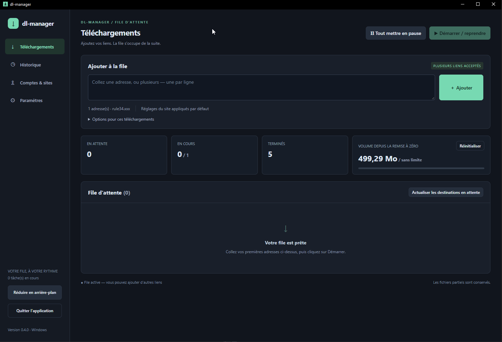
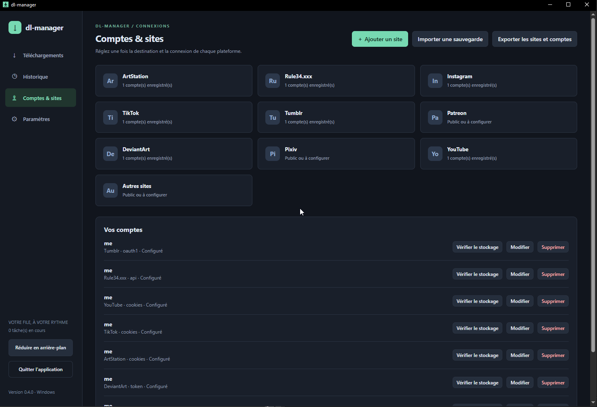

# dl-manager 0.5.0

> je ne suis pas dev, mais j'ai une idée !

[Français](guide.fr.md) · [English](README.en.md) · [Español](README.es.md) · [简体中文](README.zh-CN.md) · [日本語](README.ja.md)

Une interface pour gallery-dl et yt-dlp : collez vos liens, choisissez les images ou vidéos, puis lancez la file. Les moteurs et leurs dépendances sont fournis dans les paquets.

## Télécharger et démarrer

Ouvrez les [Releases](https://github.com/pandazor/mix-dl/releases) et les fichiers **Assets** de la version voulue :

| Votre système | Archive | Lancement |
| --- | --- | --- |
| Windows 10/11 x64 | dl-manager-0.5.0-windows-x64.zip | Extraire tout, puis ouvrir dl-manager.exe |
| Linux x64 | dl-manager-0.5.0-linux-x64.tar.gz | Extraire tout, puis lancer ./dl-manager |

Le ZIP **sources** contient le code, pas le programme prêt à lancer. Conservez ensemble le programme et le dossier tools. Sous Windows, [WebView2 Runtime](https://developer.microsoft.com/microsoft-edge/webview2/) doit être installé.

Sous Debian/Ubuntu avec un bureau graphique :

```sh
sudo apt install libgtk-4-1 libwebkitgtk-6.0-4 libsecret-tools
tar -xzf dl-manager-0.5.0-linux-x64.tar.gz
cd dl-manager
./dl-manager
```

Pour enregistrer les comptes sous Linux, un trousseau Secret Service compatible doit être ouvert et déverrouillé (par exemple GNOME Keyring ou KWallet compatible). La compilation Linux est vérifiée ; le lancement natif reste à valider. Le backend Wails purego est expérimental.

**Mise à jour :** quittez complètement l’ancienne application. Sauvegardez et conservez le dossier data ainsi que vos téléchargements, puis remplacez le programme et tools par ceux du nouveau paquet. Ne faites pas fonctionner deux versions sur les mêmes données. Pour changer de PC ou d’OS, utilisez l’export chiffré des comptes.

## Premier téléchargement

1. Dans **Paramètres → Langue**, choisissez Français, English, Español, 简体中文 ou 日本語. Le changement et sa sauvegarde sont immédiats.
2. Choisissez le **Dossier global de téléchargement**. Il se sauvegarde automatiquement quand vous quittez le champ. Enregistrez les autres paramètres avec le bouton en bas.
3. Dans **Comptes & sites**, ouvrez votre site et cochez **Utiliser le dossier global**, puis enregistrez ses réglages. Une destination propre au site prend sinon la priorité.
4. Si une connexion est nécessaire, ajoutez un compte comme expliqué ci-dessous.
5. Dans **Téléchargements**, collez une ou plusieurs adresses, une par ligne. Cliquez sur **Ajouter**, puis **Démarrer / reprendre**.



*Capture fournie par l’auteur : interface française de la 0.4.0. Le choix de langue apparaît dans Paramètres à partir de la 0.5.0.*

## Quels sites sont pris en compte ?

« Validé » signifie qu’un téléchargement a été confirmé par l’auteur sur les contenus testés ; cela ne garantit pas tous les contenus ni la disponibilité future du site.

| Site | Méthode la plus simple | État des essais |
| --- | --- | --- |
| Rule34.xxx | User ID + API Key | Téléchargements validés |
| Instagram | cookies.txt | Images et cookies validés |
| TikTok | cookies.txt | Téléchargements validés |
| ArtStation | Public, ou cookies.txt | Téléchargements validés |
| DeviantArt | Générer le token, ou refresh-token manuel | Téléchargements validés avec token manuel ; nouveau bouton à essayer en conditions réelles |
| Tumblr | Générer le token (deux valeurs) | Autorisation obtenue ; téléchargement non confirmé, quota partagé rencontré |
| YouTube | Public, ou cookies.txt si demandé | Intégré via yt-dlp ; validation utilisateur à compléter |
| Patreon | cookies.txt du compte ayant les droits | Intégré ; à valider |
| Pixiv | Refresh token | Intégré ; à valider |
| Autres sites / sites personnalisés | Public ou cookies.txt | Dépend de la [compatibilité gallery-dl](https://gdl-org.github.io/docs/supportedsites.html) |



*Capture française 0.4.0. Un compte affiché comme configuré ne prouve pas que sa connexion au site a été testée.*

## Exemple facile : Instagram avec cookies.txt

1. Connectez-vous à Instagram dans votre navigateur et ouvrez une page du compte à télécharger.
2. Utilisez [Get cookies.txt LOCALLY pour Chrome/Chromium](https://chromewebstore.google.com/detail/get-cookiestxt-locally/cclelndahbckbenkjhflpdbgdldlbecc), ou [cookies.txt pour Firefox](https://addons.mozilla.org/firefox/addon/cookies-txt/). Vérifiez bien le nom **LOCALLY** : l’ancienne extension « Get cookies.txt » a été signalée comme malveillante par le [projet yt-dlp](https://github.com/yt-dlp/yt-dlp/wiki/FAQ#how-do-i-pass-cookies-to-yt-dlp).
3. Depuis l’onglet Instagram connecté, ouvrez l’extension et exportez **uniquement les cookies du site courant**, au format **Netscape**. N’exportez pas tous les sites du navigateur. Enregistrez par exemple instagram-cookies.txt.
4. Dans **Comptes & sites → Instagram**, nommez le compte, choisissez **Fichier cookies.txt**, sélectionnez le fichier et cochez le compte par défaut si souhaité. Cliquez sur **Enregistrer le compte**.
5. Dans **Téléchargements**, collez l’adresse du profil ou de la publication, par exemple https://www.instagram.com/NOM_DU_COMPTE/ en remplaçant NOM_DU_COMPTE, puis **Ajouter → Démarrer / reprendre**.

Même principe pour TikTok, ArtStation, Patreon et YouTube quand une connexion est demandée : exportez les cookies du bon site depuis le bon compte. Les cookies donnent accès à votre session : **ne les partagez pas et ne les ajoutez jamais au dépôt Git**. Le fichier original reste sur le disque après import ; supprimez-le lorsque vous n’en avez plus besoin. Si la session expire, reconnectez-vous et recommencez l’export.

## Tokens et réglages par site

- **Rule34 :** connectez-vous au site, ouvrez les options du compte puis la rubrique API. Copiez **User ID** et **API Key** dans les champs correspondants ; ne mettez pas la clé dans une URL.
- **Tumblr / DeviantArt :** cliquez sur **Générer le token**, puis connectez-vous et autorisez gallery-dl dans le navigateur. Au retour, vérifiez les champs remplis et cliquez sur **Enregistrer le compte**. Une tentative dure au maximum cinq minutes ; le port local 6414 doit être libre. Fermer le dialogue ou annuler interrompt la tentative. Le parcours complet du nouveau bouton reste à valider avec les comptes réels.
- **Saisie manuelle :** pour Tumblr, access-token va dans **Token / API Key**, access-token-secret dans **OAuth Token Secret**. Pour DeviantArt, collez le refresh-token dans **Token / API Key**.
- **Pixiv :** obtenez un refresh-token avec la procédure [gallery-dl](https://gdl-org.github.io/docs/configuration.html#extractor-pixiv-refresh-token). Un mot de passe ou un fichier cookies ne le remplace pas.
- **Tumblr et quota :** une autorisation réussie ne garantit pas un quota disponible. La clé d’application partagée peut être épuisée ; attendez la remise à zéro indiquée dans le journal. Renouveler les tokens ne change pas ce quota. Les clés d’application personnelles ne sont pas encore prises en charge.

Le compte par défaut s’applique au lancement des tâches qui en héritent, même si elles ont été ajoutées avant lui. En pause, le compte d’une tâche peut être modifié dans **Détails**. Les champs secrets laissés vides lors d’une modification conservent leur valeur. **Vérifier le stockage** vérifie le déchiffrement local, pas l’accès au site.

**Ajouter un site :** donnez un nom et son domaine seul, sans https:// ni chemin. Chaque fiche a ses réglages et ses comptes. Le domaine et ses sous-domaines seront reconnus, à condition que gallery-dl les prenne en charge. Renommer la fiche ne déplace pas les fichiers. Pour la supprimer, retirez d’abord ses comptes et ses tâches, y compris dans l’historique.

## Dossiers, reprise et erreurs

Priorité des dossiers : option du téléchargement → dossier du site → dossier global. Le dossier hérité est résolu au premier départ ; **une tâche déjà commencée conserve son dossier pour la reprise**. Pour les anciennes tâches jamais démarrées, mettez la file en pause puis utilisez **Actualiser les destinations en attente**.

Le classement peut être plat, par site, ou par site/créateur. Les filtres Images/Vidéos et les extensions sélectionnent les formats existants ; ils ne convertissent pas les médias. Une à trois tâches peuvent être simultanées, avec limitation pour les dossiers ou comptes partagés. Le quota compte les octets de médias ajoutés, pas tout le trafic réseau ; un léger dépassement reste possible. Réinitialiser le compteur met en pause sans supprimer les fichiers.

Aucun téléchargement ne repart automatiquement au démarrage. Une file déjà active traite les liens ajoutés. Gardez data, les fichiers partiels et les destinations pour préserver la reprise et éviter les doublons. **Retirer une tâche** ne supprime pas ses fichiers. En cas d’erreur, ouvrez **Détails → Journal**, corrigez la cause, puis **↻ Remettre en attente** et **Démarrer / reprendre**. Les journaux et erreurs externes conservent leur langue d’origine.

La croix **quitte l’application** et arrête proprement les tâches. **Réduire en arrière-plan** la laisse fonctionner (zone de notification sous Windows, réduction sous Linux).

## Sauvegarder les sites et comptes

Dans **Comptes & sites → Exporter les sites et comptes**, choisissez un nouveau fichier .dlmbackup et une phrase secrète d’au moins **16 caractères**. L’export peut se faire pendant les téléchargements. Le fichier est chiffré, mais toute personne possédant aussi la phrase pourra utiliser vos accès. La phrase n’est pas conservée et ne peut pas être récupérée.

Pour importer, mettez la file en pause et attendez l’arrêt des tâches. L’import ajoute les comptes, conserve les existants et peut donc créer des doublons si vous réimportez le même fichier. Les réglages existants restent préservés sauf remplacement coché. Vérifiez les destinations après un changement d’OS. La sauvegarde n’inclut **ni téléchargements, ni historique, ni paramètres globaux, ni langue**.

Les comptes sont protégés par DPAPI sous Windows, et par une clé du trousseau Secret Service sous Linux. Copier les fichiers du coffre ne permet pas de les utiliser sous un autre compte/OS : utilisez l’export chiffré.

## Participer

Les retours de tests et [signalements de problèmes](https://github.com/pandazor/mix-dl/issues) sont bienvenus. Le lien de don n’est pas encore configuré ; [instructions pour le mainteneur](donations.md).

Code sous **AGPL-3.0-only** : [licence](../LICENSE). Les moteurs gardent leurs licences propres : [notices](../THIRD_PARTY.md). [Validation et limites](../VALIDATION.md) et [notes techniques / compilation](technical.fr.md) sont conservées en français. Les traductions peuvent être améliorées par des locuteurs natifs.
